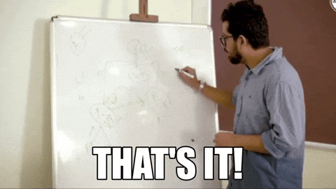

เป็นช่วงเวลาแห่งความสนธยาเมื่อพวกเราต้องมารายงานผลเมื่อสองวันที่ผ่านมา พูดตรงๆ `ผมยังไม่มั้นใจเลย` พอขึ้นถึงเวทีเลยตื้นเต้นมากๆ
โดยเฉพาะตอนเห็นว่าพี่เผ่าจะมาฟังด้วย (พี่แกคอมเมนต์กลุ่มผมก่อนพรีไว้เยอะเลย)

---

## การนำเสนอ

### รูปแบบที่พบ
การนำเสนอของ `Fibo` จะค่อนข้างคล้ายการนำเสนอโครงงานวิทยาศาสตร์ คุณต้องมีเหตุผลให้กับทุดอย่างที่คุณทำ ไม่ว่าจะเป็นการเลือกโมเดล รูปแบบการทำงานทีมใช้ จนไปถึงการตีความโจทย์ปํญหา คุณต้องพูดให้รุ้เรื่องทั้งหมด แต่ละสิ่งต่อไปนี้ยากทั้งหมดเลย

### คอมเมนต์หลังการนำเสนอ
ผมสรุปใจความได้ว่า `เรายังไม่มีระบบที่ชัดเจน` และก็ทำสไลด์บริษัทดีๆด้วย

---
