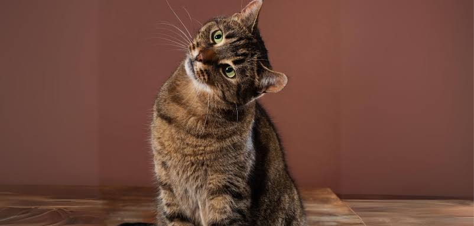
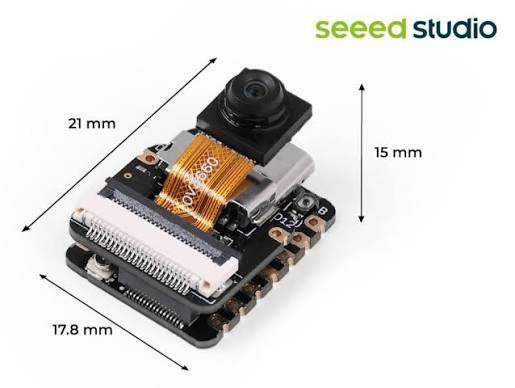

วันนี้เป็นวันแรกที่ทางโครงการให้พวกผมเขียน Blog Post ซึ่งผมพึ่งรู้ว่าต้องทำเดี่ยวและต้องทำทุกวันผมเลขตัดสินใจว่าเราจะมาลองทำแบบทำเว็บบล็อกเองดูครับซึ่งคงต้องใช้เวลาและคงไม่สวยเท่าไรแต่ผมว่ามันก็ `สนุกดีครับ`

---

## ได้เวลาเริ่มการวิเคราะห์โจทย์

หลังจากได้โจทย์มาจากทางบริษัทพวกผมก็ได้ใช้เวลาไปกับการตามหาข้อมูลที่อยู่ภายในโจทย์เช่น การทำงานของ CNN เครื่องมือที่ใช้และเราต้องรู้อะไรบ้างเพื่อทำโจทย์นี้ให้สำเร็จ

### การตีความโจทย์ของผม

ผมตีความว่ามันคือการทำ AI เพื่อหา People flow ในสถานที่ต่างๆไม่ว่าจะเป็นร้านค้าหรือใจกลางเมือง
- `ทำไมต้องทำล่ะ` - นี่คือสิ่งที่ผมสงสัยและใคร่รู้มีควอยากทำหรอหรือว่าจริงๆแล้วมันน่าสนใจกว่าที่คิด

---

## HardWare ที่กำหนด

ระหว่างที่ผมกำลังตีความโจทย์ผมก็เหลือบไปเห็นข้อมูลเกี่ยวกับบอร์ดที่เราต้องใช้คือ `Seeed studio xiao esp32s3 sense`ซึ่งเป็นบอร์ดที่ถูกสร้างมาเพื่อทำเอไอโดยเฉพาะแต่ถึงจะพูดอย่างงั้นก็ยังคงมีข้อจำกัดในด้านทรัพยากรการคำนวณ

การทำ Object Detection นั้นไม่ว่าจะเป็น two step หรือ ssd ย่อมต้องใช้งาน cpu มหาศาลหรือ gpu และยังกินแรมอีกด้วยดังนั้นแลยค่อนข้างลำบาก ซึ่งหมายวความว่าเราต้องหาวิธีในการยัดโมเดลของเราลงไปหรือทำให้โมเดลของเรามีขนาดเล็กลง

---

## การตามหาโมเดลที่เหมาะสม

เราได้ใช้เวลาตามหาจนได้มาสองวิธี

- `SWIFT YOLO`
- `FOMO`

ซึ่งเดี๋ยวเราจะมาหากันต่อในวันพรุ่งนี้นะจ้ะ